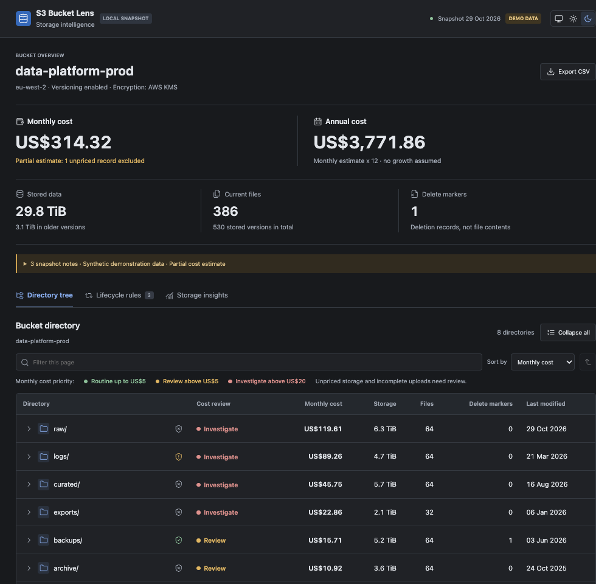

# `s3-bucket-lens`

A command-line tool that stores S3 object metadata in DuckDB and builds offline folder-tree reports with storage estimates and red/amber/green cost ratings.



> [!NOTE]
> Example dashboard generated by `s3-bucket-lens build`.

## How It Works

The scanner uses boto3 and your configured AWS credentials to read object metadata; it does not download object contents. It stores snapshots in DuckDB and generates a static HTML dashboard with folder-level storage estimates and RAG cost ratings. The dashboard works offline; share the HTML file and its companion `.report` folder together.

## CLI

Requires [uv](https://docs.astral.sh/uv/), Python 3.11+ and an authenticated AWS profile. For SSO, first run `aws sso login --profile PROFILE`.

### Commands

| Command | Description |
| --- | --- |
| `catalogue BUCKET` | Fast, parallel and resumable inventory of current S3 objects into DuckDB and Parquet. Excludes historical versions and delete markers. |
| `extract BUCKET` | Comprehensive, read-only audit of object versions, delete markers, multipart uploads and bucket configuration. Slower, serial and not resumable. |
| `build SNAPSHOT` | Generate an HTML dashboard offline from a catalogue directory or DuckDB snapshot. |
| `demo` | Create a local sample snapshot for building a dashboard. |

### Options

| Applies to | Options |
| --- | --- |
| `catalogue`, `extract` | `--profile`, `--region`, `--prefix`, `--output`, `--report-output`, `--memory-limit`, `--no-open` |
| `catalogue` | `--workers` (parallelism), `--resume`, `--expected-objects N` / `--expected-pages N` (rough ETA) |
| `extract` | `--snapshot-only`, `--skip-multipart-sizes`, `--access-csv` / `--access-logs` (access evidence) |
| `build` | `--output`, `--memory-limit`, `--no-open` |

### Example

Catalogue a bucket and generate an HTML dashboard directly from GitHub. `uvx` downloads the project and its dependencies into an isolated, cached environment, so no clone or manual package installation is needed.

```sh
uvx --from 'git+https://github.com/ThomasHepworth/s3-bucket-lens.git' s3-bucket-lens catalogue my-bucket \
  --profile my-profile \
  --region eu-west-1 \
  --output my-bucket.catalogue \
  --report-output my-bucket.html
```

Run `s3-bucket-lens <command> --help` for detailed option descriptions.

## Limits And Safety

- In `eu-west-1`, S3 LIST requests cost $0.005 per 1,000; GET and other requests cost $0.004 per 10,000. With full 1,000-key pages, one catalogue of 1 million objects is roughly $0.005 in LIST charges (100 million: about $0.50). Prefix discovery, retries and `extract` version/multipart listings add requests. Storage and data transfer are separate. See [Amazon S3 request pricing](https://aws.amazon.com/s3/pricing/).
- Scans are read-only and do not download object contents. A scan is not an atomic snapshot if objects change while it runs.
- Storage costs are estimates, not invoices; request, retrieval, transfer, account-wide tiers and discounts are excluded.
- Snapshots and reports can contain object keys and bucket configuration; share them privately.
- Cleanup scripts are separate from the scanner and can delete data; review their targets and safeguards before use.

See the [data model and Python API](docs/data-model.md) for more detail.

## Development

```sh
uv sync --locked
uv run --frozen pytest
uv run --frozen ruff check src tests
uv run --frozen ruff format --check src tests
uv build
```